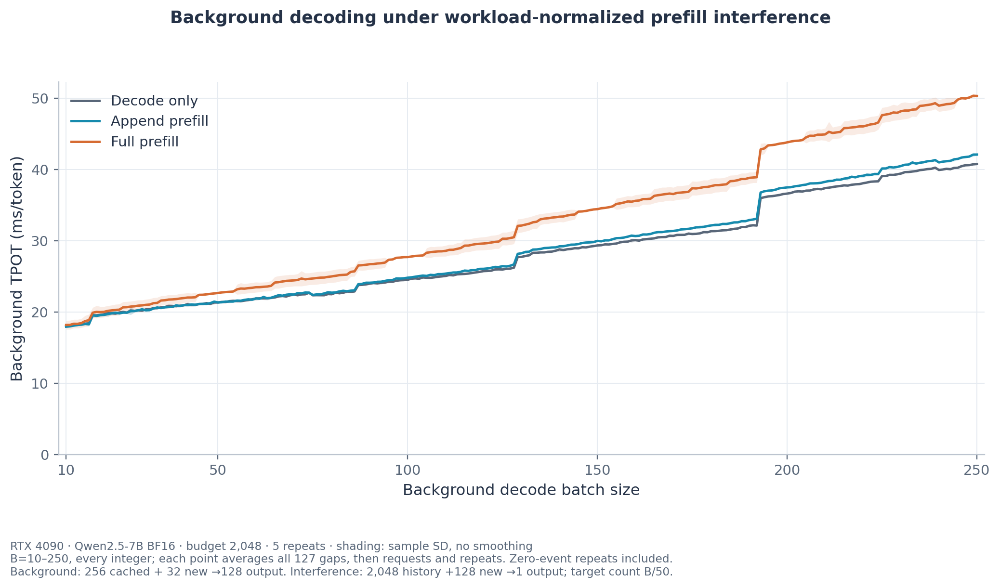
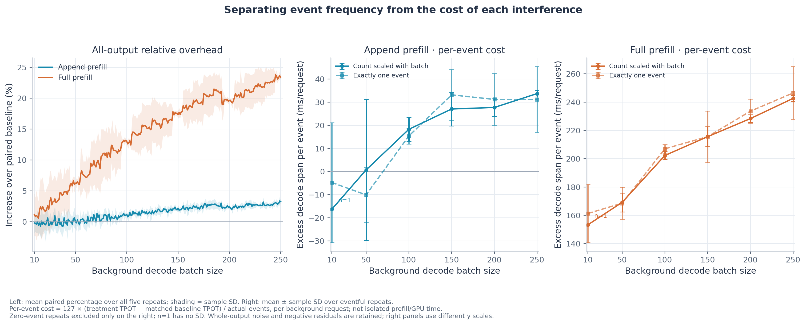

# Phase10：密集 batch 与按背景工作量安排干扰

本轮为单 RTX 4090、Qwen2.5-7B BF16 的适配实验，保留此前 Phase10 结果。正式覆盖 batch=10～250 的全部 241 个整数，每条件五次重复；三种主场景共 3,615 组，六个代表 batch 的固定单次对照共 60 组。先导不混入正式结果。

正式审计通过：3,675 组、972,725 条请求（含历史预热），输出 61,621,575 tokens；实际干扰事件 6,350 个。最大调度 2048 tokens、251 条序列，无抢占。缓存、计算量、输入配对与输出长度均逐请求核验。

背景：独立256历史＋32新增，固定输出128。干扰：独立2048历史＋128新增，固定输出1；Append复用历史、计算128，Full冷盐重算2176。每trial清缓存，各条件均预热B条背景和ceil(B/50)条独立干扰历史。预算2048、最大序列251、FCFS连续批处理、chunked prefill、eager、显存比例0.94。

在输出8～104之间，每4,800个背景decode token推进量安排一次干扰，目标平均次数B/50。用五个均匀相位分配到五次重复，相位按固定种子和batch置换，与运行延迟无关；同batch/repeat的Append与Full使用同一输入及触发点。累计次数取最接近B/10的整数，恰好半个时向上；五次平均的误差最多0.1次。batch10的五次重复合计一次，不强制每次至少一次。触发依据所有背景已达到的输出进度，实际首次调度及排队另行记录。

全输出TPOT先按每条背景(末token−首token)/127计算，再对请求与五次重复平均；包含零事件重复。下表均值±样本标准差，单位ms/token。

| Batch | 平均干扰次数 | Decode only | Append | Full |
|---:|---:|---:|---:|---:|
| 10 | 0.2 | 17.99 ± 0.14 | 17.96 ± 0.18 | 18.20 ± 0.61 |
| 50 | 1 | 21.35 ± 0.11 | 21.36 ± 0.14 | 22.68 ± 0.08 |
| 100 | 2 | 24.54 ± 0.04 | 24.83 ± 0.07 | 27.73 ± 0.02 |
| 150 | 3 | 29.36 ± 0.17 | 30.00 ± 0.02 | 34.45 ± 0.03 |
| 200 | 4 | 36.64 ± 0.07 | 37.51 ± 0.07 | 43.83 ± 0.10 |
| 250 | 5 | 40.79 ± 0.12 | 42.12 ± 0.12 | 50.34 ± 0.09 |

五步窗口以实际首个prefill调度为起点，包含该步和后续四步；按请求编号和输出序号匹配同次基线，重叠步骤去重。只汇总有事件且窗口完整的重复，每个batch实际样本数与事件数保留；n=1时没有可估计的样本标准差。局部排除不完整或SSE合并隐藏的间隔，共21,788步；SSE合并事件0个；全输出端点统计保留。异常峰值和负配对差值不删除，不做平滑或趋势筛选。

六组图：全输出TPOT、单次对照超额TPOT、五步窗口及贡献重复数、六个代表batch逐步轨迹、干扰负载与基线调度核验，以及相对开销与单次干扰成本。图和可独立重画数据在results/figures/phase10/dense-workload/。

增加次数改变负载；本实验是按背景工作量归一的干扰，不是固定每秒到达率。更多batch点不能单独证明固定一次干扰的硬件扩展机制，也不能声称完整复现H100论文Figure2。token比不是FLOP比；GPU采样包含模型与KV预分配，不能解释为每步有效KV占用。客户端SSE间隔包含主机调度和网络等开销，并非CUDA kernel计时。输入及输出长度配对，不强制生成正文逐token一致。

证据在artifacts/phase10-dense-workload-evidence/：每个batch/repeat的全部原始请求、SSE、事件、响应、指标、调度trace与审计保存为archives/*.tar.gz；archive-manifests/提供逐文件SHA256，压缩包重新读取逐文件验证后才删除暂存副本，并同步dcn9校验。summaries/与completed-groups.json保留逐组分析；失败停机并保留暂存，不静默重试。导出仅在组间无测量请求时进行，导出成功后清除已保存的观察记录，限制内存占用。

本轮曾因调度记录导出为空而中断；对应请求成功但缺少调度证据，原失败样本保存在scratch/，不混入正式结果。获准恢复后保留既有审计通过结果，仅重跑失败配对组并继续剩余扫描。恢复先导不计入正式结果；恢复版只修改证据导出及控制流程，输入、调度参数、统计和审计保持一致。各次运行源码与恢复核验保存在resume*/，图的source-provenance.json记录全部源码版本。

## 结果解读

Full干扰明显重于Append。batch=250时，相对无干扰的全输出TPOT增加：Append 3.26%，Full 23.42%；Append比Full的背景TPOT低16.34%。这些是背景decode的延迟，未把干扰请求自己的TTFT作为纵轴。

低batch的全输出曲线接近，不代表插入prefill时完全没有停顿。batch=10的五次重复合计只有一次干扰，其余四次为零事件；一次短暂停顿又均摊到127个输出间隔。所以Full全输出TPOT仅增加1.12%，但真正有事件那次的五步窗口仍比匹配基线高35.11 ms/token。此点窗口样本n=1，不能估计重复间标准差。batch=250的五步窗口超额为Append 6.49、Full 48.06 ms/token，两者都说明干扰主要表现为局部峰值。

曲线差距扩大包含明确的负载次数因素。Full固定单次对照中，batch=10→250的全输出超额TPOT仅从1.27增加至1.94 ms/token；按batch增加次数时却从0.20增加至9.55 ms/token。以batch=50→250为例，干扰次数由1变5，全输出Full超额约增至原来的7.17倍；固定单次对照只增至1.46倍。因此，本轮能证明当前负载规则下Append降低干扰，也有单次成本随batch上升的迹象；不能把完整斜率都归因为GPU在大batch下的资源争用，更不能视作原论文固定实验条件的直接复现。

所有已记录Append事件均一次计算128个新增token；Full都分为两块计算总计2176个token。首块需与背景decode共享2048预算，次块完成剩余部分，所以Full会造成较大的局部decode间隔。图中基线本身在batch=129和193附近也发生台阶：即使没有prefill仍然存在，且没有KV抢占。仅凭现有时延和低频GPU采样不能确定具体kernel/执行路径原因，报告保留台阶，不归因于显存不足。

## 图和数据索引

| 文件 | 含义 |
|---|---|
| [background-tpot.png](../results/figures/phase10/dense-workload/background-tpot.png) | 主图：全部输出间隔的背景TPOT，五次均值±样本标准差，保留零事件重复 |
| [single-vs-multiple.png](../results/figures/phase10/dense-workload/single-vs-multiple.png) | 扣除配对基线后，比较固定单次与随batch增加次数的开销 |
| [first5-background-tpot.png](../results/figures/phase10/dense-workload/first5-background-tpot.png) | 每次干扰实际被调度起的五步窗口；重叠窗口去重，下排报告参与重复数 |
| [decode-step-trajectories.png](../results/figures/phase10/dense-workload/decode-step-trajectories.png) | 六个代表batch各次重复的逐步间隔；峰值不平滑、不删除 |
| [workload-verification.png](../results/figures/phase10/dense-workload/workload-verification.png) | 干扰次数、计算token比例和基线调度步数 |
| [interference-cost.png](../results/figures/phase10/dense-workload/interference-cost.png) | 相对TPOT开销，以及每个事件对应的背景请求超额输出跨度；后者保留噪声，不是纯GPU耗时 |

每张图均提供同名SVG/PDF。`anchor-summary.csv`提供六个代表点，`group-summary.csv`提供全部735种条件的均值、标准差和样本数；`result-analysis.json`提供配对百分比及按事件归一的统计。图中阴影为样本标准差，不是置信区间。小幅负超额保留，不能据此声称prefill提高性能。

日志中的观察器平均开销约60.3微秒（按组均值平均），最大单步观察器时间约135.3毫秒。偶发主机调度/观察器长尾未剔除；因此单个局部异常不能直接解释为GPU kernel变慢。五步窗口排除的是不完整的全batch步等无法严格配对的间隔，而非按延迟大小删除样本；全输出端点统计保留全部正式请求。
