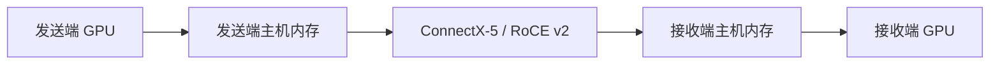

# 双机阶段六：RDMA 条件与跨机通信验证

2026-11-11 UTC，已完成本阶段三项检查并暂停：设备/容器条件、主机内存 RoCE 微测试、同镜像 GPU NCCL 通信路径。验收文件 `verification.json` 的 `passed=true`。

结论：两端 ConnectX-5 的 RoCE v2 可用，同一运行镜像映射设备后可以进行 NCCL IB 数据传输；当前 RTX 4090/580.95.05 驱动组合的 CUDA GPUDirect RDMA 和 DMA-BUF 能力查询均返回 0，已验证的 GPU 通信采用主机内存中转。现有模型服务仍为 Socket，未切换推理传输协议。

## 第一步：宿主机、RoCE 和容器

- dcn9 `192.168.1.9`、dcn10 `192.168.1.11`，均使用 `ens7f0np0` / `rocep202s0f0:1`，链路 ACTIVE、100G。
- 两端业务 IPv4 对应的 RoCE v2 GID 均为索引 3。测试显式选定该 HCA、端口和 GID。
- Ethernet MTU 均为 1500，RDMA active MTU 为 1024；本次保持该设置并以 1024 测试。dcn9 第二端口仍为 DOWN，未使用。
- mlx5_core/mlx5_ib/ib_uverbs 已加载，主机已有 rdma-core 28 和 perftest 4.4。两端 NIC 固件分别为 16.35.4506 / 16.35.4030，内核分别为 5.15.0-67 / 5.15.0-139；本阶段未修改。
- 原 P/D 容器未映射 `/dev/infiniband`。新建两个独立测试容器 `ppd-rdma-probe-dcn9` / `ppd-rdma-probe-dcn10`，仍使用 `ppd-qwen25:source-cu129`，加入 `--device /dev/infiniband`、GPU 0、host network、容器 memlock unlimited。
- 同镜像已包含 libibverbs/libmlx5；两个测试容器均成功枚举并打开所选 HCA。无需安装依赖或生成新镜像。
- CUDA 属性 116（GPU_DIRECT_RDMA_SUPPORTED）、124（DMA_BUF_SUPPORTED）、110（GPU_DIRECT_RDMA_WITH_CUDA_VMM_SUPPORTED）均查询成功，值均为 0。`nvidia_peermem` 有模块文件但未加载，本阶段没有加载它。

实际可用路径如下：

## 第二步：主机内存 RDMA 微测试

`ib_write_bw` 每个方向分别测 1 MiB、8 MiB，每种消息大小重复 3 次，每次 duration 5 秒、margin 1 秒；`ib_write_lat` 每个方向测 8 B、4 KiB，各 1000 次。总计 16 个工具测试全部成功。两方向依次运行，没有做双向同时带宽测试。

| 方向 | 1 MiB 带宽中位数 Gbit/s | 8 MiB 带宽中位数 Gbit/s | 8 B t_typical μs | 4 KiB t_typical μs |
|---|---:|---:|---:|---:|
| dcn9 → dcn10 | 92.49 | 94.17 | 1.17 | 2.25 |
| dcn10 → dcn9 | 92.00 | 91.93 | 1.33 | 2.58 |

带宽栏是三次工具平均带宽的中位数；时延栏是 perftest 自身报告的 t_typical。原始 min/max/avg/percentile 均保留，不把这些主机内存工具时延当成 GPU 通信或请求 TTFT。

结果入口：`host-memory-bandwidth.csv`、`host-memory-latency.csv`、`perftest-results.json`。原始工具输出在 `ib_write_*-client/server.log`，精确参数在对应 `*-commands.json`。

## 第三步：GPU NCCL 实际路径

新增独立工具 `scripts/tests/two_node_rdma_probe.py`，在上述两个容器各运行一 rank。先验证 all-reduce 的 1+2=3，再双向发送 GPU 字节张量，接收端校验全部内容，并返回一个 GPU 确认消息。

- forced-ib：显式 `NCCL_NET=IB`，双向测试 1 KiB、1 MiB、16 MiB、64 MiB。每方向/大小预热 3 次，正式测试 2 轮、每轮 10 次。
- auto：不指定 `NCCL_NET`，保持 HCA/GID、`NCCL_IB_DISABLE=0` 等条件，双向测试 1 KiB/1 MiB，各预热 3 次、正式 5 次。
- 均使用 `NCCL_NET_GDR_LEVEL=LOC`，验证主机内存中转。两种选择方式、两个 rank 全部成功，接收内容校验全部通过。
- 四份日志均出现 `Using network IB`、`rocep202s0f0:1/RoCE`、数据 channel `via NET/IB/`、`GID 3`、`GPU Direct RDMA Disabled`；未出现 Socket 数据 channel 或 NCCL WARN。

NCCL 的 `IB` 是 verbs 后端名称；本机物理链路为 Ethernet/RoCE v2。用于进程集合和连接建立的 TCP 通信仍然存在，不能把控制连接当成 Socket 数据传输或回退。

64 MiB 的源端观测结果如下：

| 方向 | 每次负载+GPU确认往返 ms | 负载有效速率 Gbit/s |
|---|---:|---:|
| dcn9 → dcn10 | 5.893 | 91.11 |
| dcn10 → dcn9 | 5.888 | 91.18 |

计时是 Python perf_counter，包括 GPU 确认和 CUDA 同步；每轮先求 10 次平均，再取两轮中位数。有效速率用消息字节数除以上述往返时间计算，不是单向原始时延或模型 KV 传输测量。全部大小结果见 `nccl-source-results.csv` 和 `nccl-*-results.json`。

PyTorch 日志保留了 eager-init 下未批量 P2P 操作被串行化的警告，这是本工具同步收发方式的限制；不据此宣称峰值 NCCL 性能。模型 connector 的逐层异步行为仍需独立验证。

## 最终状态与验收边界

两个测试容器已停止并删除，原 Proxy/P/D 的容器 ID、镜像 ID、StartedAt 均保持不变，最后健康接口均通过，Proxy 仍为静态 `1P_1pD`。显存回到原先约 18.5 GiB 占用水平；没有新建镜像、修改全局网络/MTU/驱动/固件、加载内核模块或改变模型服务配置。选定 RDMA 错误计数器在测试前后增量均为 0，详见 `verification.json`。

本阶段没有发送模型推理请求，因此没有新的请求 TTFT/TPOT。阶段五的 192 条记录保留原样。本阶段证明 RDMA 链路及独立 GPU NCCL 通信可用；还未验证 vLLM P2pNcclConnector 在 RDMA 下的真实 KV 推理、prefix cache、性能或长时间稳定性。

下一阶段可重建 P/D 容器映射 RDMA 设备、选择 rdma transport 和已验证参数，先做一组 PD/静态 PPD 两轮 KV 推理验收，再与阶段五相同负载比较逐请求 TTFT/TPOT。本阶段到此暂停。

## 证据位置

两端统一目录 `/home/dell/xwd/vllm-ppd/artifacts/two-node-phase6-evidence/`：

- `README.md`：文件阅读入口。
- `verification.json`、`audit.log`：三项检查及服务保留状态的验收。
- `*-inventory.json`、`*-after-inventory.json`、`inventory-summary.json`：原始宿主机状态和 GID/MTU/映射概要。
- `*-container-probe.json`：实际容器 verbs 打开结果、CUDA 能力和 PyTorch/NCCL 版本。
- `host-memory-*.csv`、`nccl-source-results.csv`：便于阅读的测量表。
- `nccl-*.log` / `nccl-*-commands.json`：实际网络选择、数据 channel 和准确命令。
- `*-probe-cleanup.log`、`final-health.json`：独立容器清理、原模型服务健康证据。
- `run-perftest.py` / `run-nccl.py` / `audit-phase6.py`：本次实际测试和验收脚本，运维脚本依赖当前 CLI 的 `host_exec.py`。
