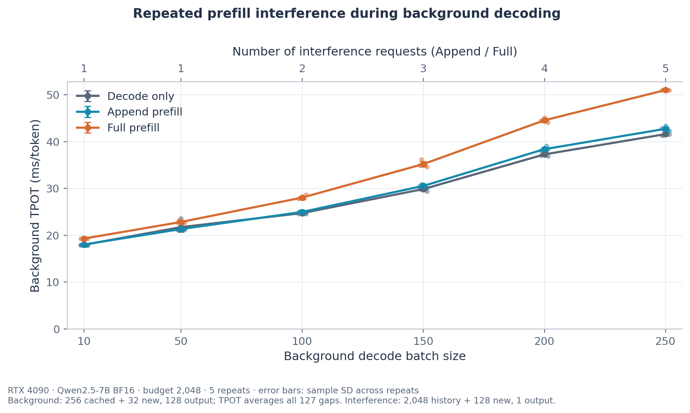
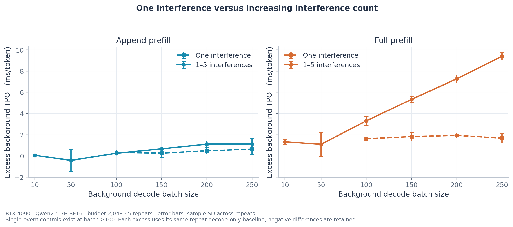
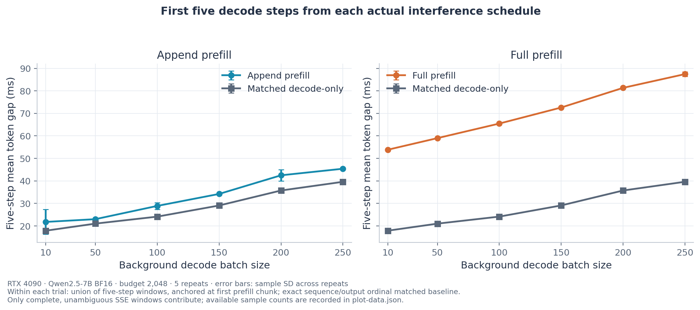
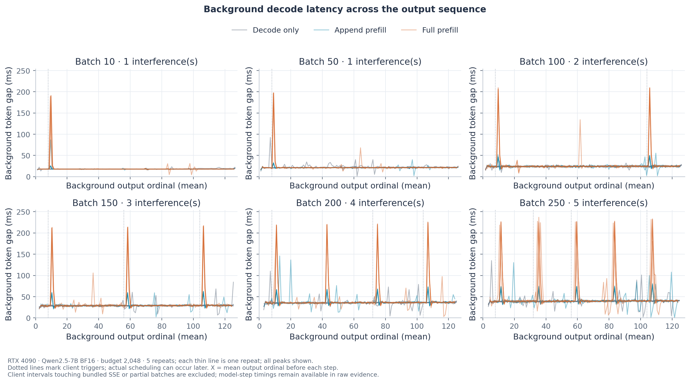

# Phase 10：随背景 batch 增加 prefill 干扰次数

2026-11-23，dcn9 单张 RTX 4090，Qwen2.5-7B-Instruct BF16。90 组主实验＋40 组单次对照，130 组、每条件 5 次重复；37,380 条请求（含预热）全部成功，18,400 条背景请求固定输出 128 tokens，200 条干扰请求固定输出 1 token。另有 3 组 batch 250 先导，不进入此处结果。

背景为独立 256-token 历史＋32-token 新增；干扰为独立 2,048-token 历史＋128-token 新增。Append 命中 2,048-token 历史，只计算 128 tokens；Full 使用同一完整输入和冷 cache salt，重算全部 2,176 tokens。预算固定 2,048，最大序列 251，FCFS 连续批处理、chunked prefill、eager、prefix caching；实际 KV 池 120,624 tokens，显存比例 0.94。

batch 10、50、100、150、200、250 分别加入 1、1、2、3、4、5 次干扰。发送由所有背景的最低输出进度触发：8；8；8/104；8/56/104；8/40/72/104；8/32/56/80/104。batch≥100 另有仅在输出 8 后发送一次的 Append/Full 对照。

## 全输出背景 TPOT



纵轴是背景请求 `(末 token 到达−首 token 到达)/127`，先平均请求，再汇总 5 次重复的均值和样本标准差。散点保留全部重复，不是干扰请求的 TTFT。单位均为 ms/token。

| 背景 batch | 干扰数 | Decode only | Append | Full |
|---:|---:|---:|---:|---:|
| 10 | 1 | 17.98 ± 0.20 | 18.04 ± 0.21 | 19.30 ± 0.03 |
| 50 | 1 | 21.75 ± 1.06 | 21.33 ± 0.04 | 22.85 ± 0.22 |
| 100 | 2 | 24.74 ± 0.16 | 24.99 ± 0.09 | 28.05 ± 0.34 |
| 150 | 3 | 29.86 ± 0.34 | 30.53 ± 0.28 | 35.20 ± 0.60 |
| 200 | 4 | 37.26 ± 0.39 | 38.38 ± 0.42 | 44.54 ± 0.37 |
| 250 | 5 | 41.59 ± 0.36 | 42.73 ± 0.41 | 51.00 ± 0.07 |

## 单次与多次对照



纵轴为相同 batch/repeat 的背景 TPOT 减去 Decode only。负差异和长尾全部保留。下表为配对超额 TPOT 的均值（ms/token）。

| 背景 batch | Append 单次超额 | Append 多次超额 | Full 单次超额 | Full 多次超额 |
|---:|---:|---:|---:|---:|
| 100 | 0.33 | 0.25 | 1.62 | 3.31 |
| 150 | 0.27 | 0.67 | 1.82 | 5.33 |
| 200 | 0.49 | 1.11 | 1.94 | 7.28 |
| 250 | 0.64 | 1.13 | 1.68 | 9.40 |

batch 250 的 Full 从单次 43.27 增至五次 51.00 ms/token，基线 41.59；Append 从单次 42.23 增至五次 42.73。增加次数明显放大 Full 的整段平均影响；这里未进行统计显著性检验。

## 五步事件窗口



每个事件以**首次实际 prefill 调度**为零点，取该步和后续四个背景 decode 步。按背景编号、输出序号匹配基线，在 trial 内先对全部事件窗口按 step 去重，再取均值，最后汇总五次重复。不是客户端发送后计时五个毫秒，也不是干扰请求的输出 TPOT。全部 200 个五步窗口完整，各条件 n=5。

batch 250 中 Append 的窗口均值为 45.39 ms，对应基线 39.57；Full 为 87.44 ms，对应基线 39.59。这些窗口基线只对应被干扰的输出位置，所以不同于全输出 41.59 ms/token。

## 逐步延迟轨迹



每条细线是一轮重复；横轴为该步背景输出序号的平均值，纵轴为该步所有背景的平均 token 到达间隔。虚线是客户端进度触发点，真正调度可能更晚。所有六个子图采用相同纵轴范围，保留全部峰值，没有平滑或删除长尾。图中会出现 1 至 5 次 Full 峰值；单次 Full 实际包含两个 prefill chunks。

## 证据与限制

- 请求输入按固定种子和背景编号独立构造；同 batch/repeat 的条件复用同一组输入，盐值隔离请求缓存。每 trial 调用清缓存接口，各条件预热全部同量历史，Full 使用冷盐值。
- 所有 Full 事件恰有两个 chunks、累计 2,176 tokens；Append 恰有一个 chunk、128 tokens。全部混合步骤包含完整 B 条背景，无抢占，最大调度量 2,048 tokens、251 条序列。服务日志无运行时 ERROR、CUDA OOM。
- 未发现 SSE 合并多个 token 的事件。局部分析排除 935 个不完整的背景/匹配基线 batch 步；不排除整段 TPOT。1/5/chunks 窗口均为 200/200 完整，16 步窗口为 199/200，缺失如实保留。
- GPU 显存采样均为 23,215 MiB，主要体现预分配的模型与 KV 池，不能把它解释为每步有效 KV 占用。0.5 秒采样无法分辨单个短调度步。
- 调度观察在正式背景步骤的平均开销约 0.154 ms，有 10 步超过 50 ms，最大约 109.88 ms；这些长尾全部保留。小幅负超额不应解释为加入干扰必然加速。
- 输入和输出长度配对，生成正文不强制逐 token 一致：14,600 条处理组背景中 9,641 条正文与对应基线完全相同。不同动态 batch 下 temperature=0 也不保证数值路径完全一致；本实验控制计算形状和长度，未强制固定生成轨迹。
- 增加干扰次数改变了负载，因此不能把主曲线斜率全部归因于固定单次干扰的 batch 扩展机制。本结果属于 4090 的适配实验，不能声称完整复现原论文 H100 Figure 2。

原始请求/SSE、失败记录位置（本轮无推理失败）、调度记录、metrics、GPU 采样、冻结源码、先导及正式审计均在 `artifacts/phase10-multi-interference-evidence/`。收尾发生一次重复 trace 导出与打包并行的错误，已恢复；恢复文件 SHA256 与正式审计完全一致，没有重跑请求。详细说明在阶段报告和 evidence 的 `postprocessing-incident.json`。

## 重画

```bash
python -m pip install -r requirements.txt
python generate.py
```

`plot-data.json` 保存全部 trial、组统计、事件与正式审计；`step-trajectories.json` 保存图中每步数据；`event-windows.json` 保存四种窗口的逐事件结果；`measurement-diagnostics.json` 保存观察开销、显存与输出配对诊断。`generate.py` 可独立生成上述四组 PNG/SVG/PDF。运行源码和最终绘图源码的 SHA256 在 `source-provenance.json`。完整方案与阶段报告见 [TWO_NODE_PHASE10.md](../../../docs/TWO_NODE_PHASE10.md)。
