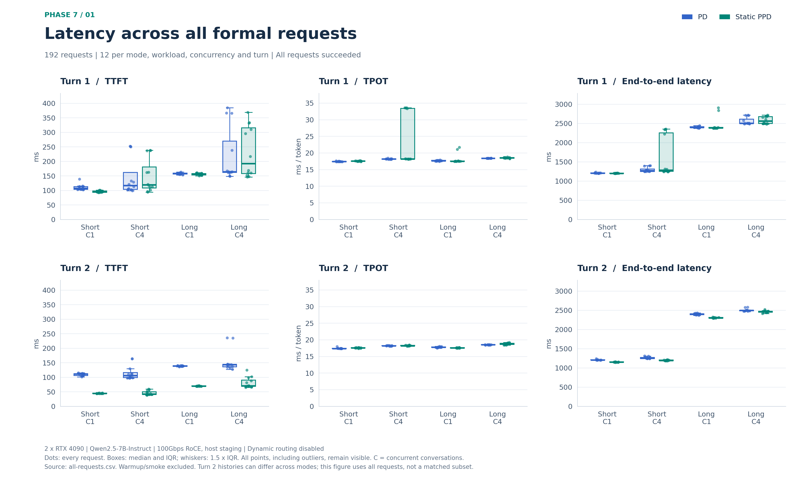
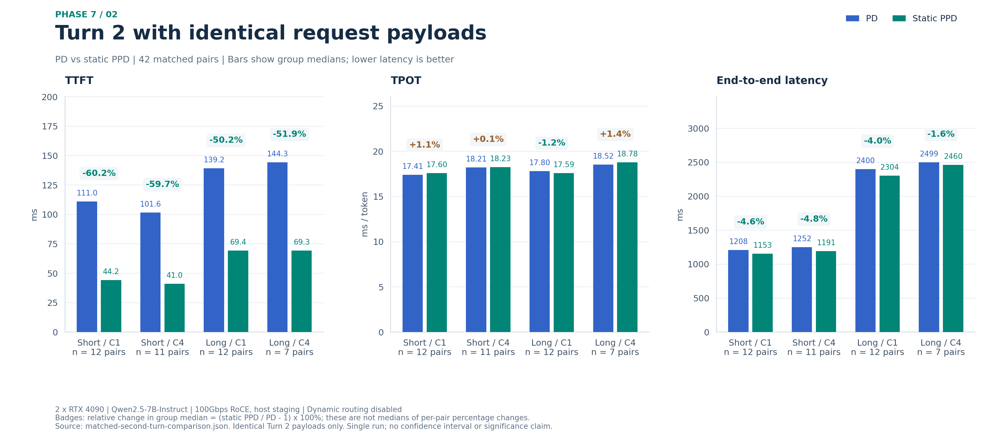
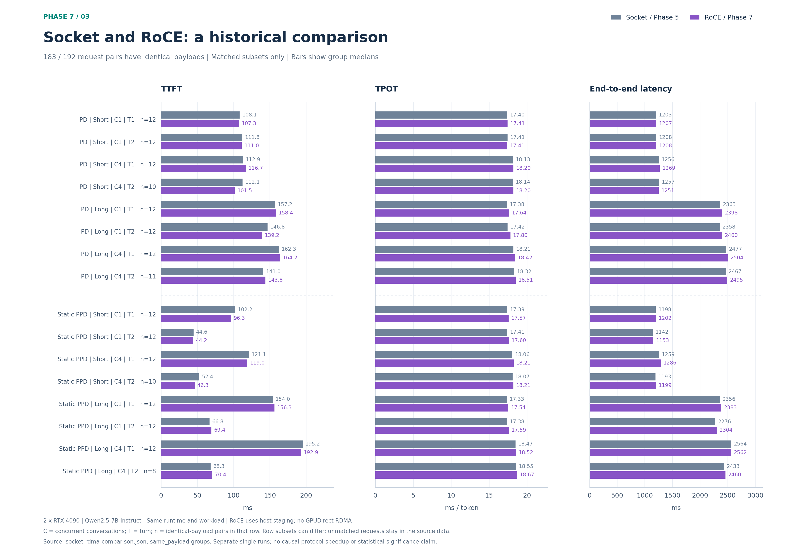

# Phase 7：双机 RoCE 下的 PD 与静态 PPD

保存 Phase 7 的三张汇总结果图，每张提供 PNG、SVG 和 PDF。图内使用英文标签，以下提供中文说明。图片已生成，未提交或推送到 GitHub。

## 结果图

### 1. 全部正式请求的延迟分布



[PNG](all-requests-latency.png) · [SVG](all-requests-latency.svg) · [PDF](all-requests-latency.pdf)

- 来源：`all-requests.csv`，192 条正式请求，全部成功；不含预热和 smoke。
- 上下两行分别为第一轮、第二轮；三列分别为 TTFT、TPOT 和请求总耗时。
- 蓝色为 PD，绿色为静态 PPD。Short/Long 是负载类别，C1/C4 为并发对话数，不是实际引擎 batch size。
- 每种模式、负载、并发、轮次有 12 个样本。散点显示每条请求，箱体为四分位区间，中线为中位数，须线延伸至 1.5 倍四分位距范围内的最远观测值；所有离群点保留显示。
- 相同指标在两轮中使用相同纵轴尺度，并从零开始。图中可见部分第一轮请求的较高耗时；没有删除或裁掉这些样本。
- 此图保留全部第二轮请求，其历史输入可能因第一轮回答不同而不同；严格输入配对的比较见下一张图。

### 2. 相同第二轮输入下的 PD / 静态 PPD 对比



[PNG](matched-turn2-comparison.png) · [SVG](matched-turn2-comparison.svg) · [PDF](matched-turn2-comparison.pdf)

- 来源：`matched-second-turn-comparison.json`。按 Short/C1、Short/C4、Long/C1、Long/C4 排列，相同输入对数分别为 12、11、12、7，共 42 对。
- 柱高为各组延迟中位数，柱上标注实际数值；上方百分比为 `(静态 PPD 中位数 / PD 中位数 − 1) × 100%`，不是逐对改善百分比的中位数。
- 四组 TTFT 中位数分别下降约 60.2%、59.7%、50.2%、51.9%；TPOT 中位数变化约 +1.1%、+0.1%、−1.2%、+1.4%。
- 此实验支持静态路径下的观测结果，不能证明动态策略收益；没有从单次小样本实验构造置信区间或显著性结论。

### 3. Socket / RoCE 的历史运行对比



[PNG](socket-roce-comparison.png) · [SVG](socket-roce-comparison.svg) · [PDF](socket-roce-comparison.pdf)

- 来源：`socket-rdma-comparison.json` 中的 `same_payload` 子集，192 对跨阶段请求中有 183 对输入完全相同；没有混用 `all` 子集。
- 灰色为 Phase 5 Socket，紫色为 Phase 7 RoCE。每行给出模式、负载、并发、轮次及匹配对数 `n`；柱高为对应子集的中位数。
- 不同第二轮条件的匹配子集大小不同，不能把所有行视为同一组会话。未匹配请求仍保留在原始证据中。
- TTFT 有升有降，TPOT 大体接近。这是不同时间的历史单次运行比较，不能将差异直接归因于传输协议。

## 重新生成

绘图脚本为 [generate.py](generate.py)，依赖记录在 [requirements.txt](requirements.txt)。当前环境将绘图依赖安装在既有 `/workspace/ppd-paper-tools` 中，没有修改模型服务环境。

从项目根目录使用原始证据生成三张图，并更新绘图数据快照：

```bash
/workspace/ppd-paper-tools/bin/python results/figures/phase7/generate.py
```

仅使用此目录中的 [plot-data.json](plot-data.json) 重新生成，不需要下载 `artifacts/`：

```bash
python -m pip install -r results/figures/phase7/requirements.txt
python results/figures/phase7/generate.py --from-snapshot
```

脚本一次导出三张图的 PNG（220 DPI）、SVG 和 PDF。可用 `--output-dir` 指定其他输出目录。`plot-data.json` 保存绘图所需的逐请求字段、两份比较数据和三个原始输入文件的 SHA-256，便于独立复现；它不包含原始请求正文、SSE 或服务日志。

## 数据来源

- [阶段报告](../../../docs/TWO_NODE_PHASE7.md)
- 原始证据：`artifacts/two-node-phase7-evidence/`，相对于项目根目录；该目录未纳入 Git。
- `all-requests.csv`：192 条正式请求，PD 与静态 PPD 各 96 条，不含预热和 smoke 请求。
- `matched-second-turn-comparison.json`：两种模式下输入完全相同的 42 对第二轮请求，适合展示第二轮 TTFT/TPOT 对比。
- `socket-rdma-comparison.csv/json`：Phase 5 Socket 与 Phase 7 RoCE 的历史运行比较，区分全量和相同输入子集。

## 绘图口径

- 环境为两台各一张 RTX 4090、Qwen2.5-7B-Instruct、100Gbps RoCE，经主机内存中转，未启用 GPUDirect RDMA。
- 模式为静态 PD（`1P_1D`）和静态 PPD（`1P_1pD`），未启用动态策略。
- 图中须标明负载、并发、轮次、单位、统计量与样本数；区分全部请求和相同输入子集。
- TTFT 为客户端发起 POST 至首段非空正文；TPOT 为 `(SSE EOF 时间 − 首正文时间) / (输出 token 数 − 1)`。
- 这是单次、闭环、小样本合成负载实验；Socket 与 RoCE 在不同时间运行，不能仅凭差值推断协议收益或统计显著性。
- 图应标注为当前双机硬件上的实验结果，不能称为论文完整 Figure 复现或动态 PPD 收益验证。

