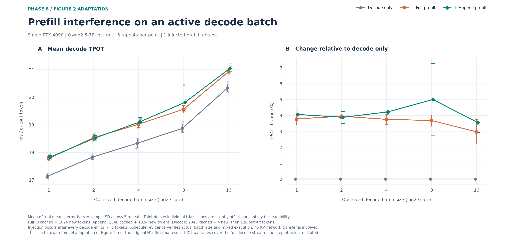

# Phase 8：论文 Figure 2 的单 RTX 4090 适配

后续扩大 batch 的实验独立保存在 [large-batch/](large-batch/README.md)：包含共享历史到 250 路的曲线及独立历史 batch 32 对照。下文保留首轮 batch 1–16 的结果，不混合两轮实验。

比较正在 decode 的同一张 GPU 上，加入一次 full-prefill / append-prefill 后的平均 TPOT。模型为 Qwen2.5-7B-Instruct，decode batch 为 1、2、4、8、16，每点五次独立 trial。详细方法、异常尝试及验收见 [阶段八报告](../../../docs/TWO_NODE_PHASE8.md)。



同图下载：[PNG](figure2-interference.png)、[SVG](figure2-interference.svg)、[PDF](figure2-interference.pdf)。

左面板是背景 decode 的平均 TPOT，右面板是相对同一 batch/重复的纯 decode 基线的变化。先对每个 trial 的背景请求求均值，再汇总五个 trial；误差棒为样本标准差，淡色点为各 trial。横轴为 log2 刻度，三条曲线略作水平偏移以便区分。

两种干扰都实际计算 1024 个新 token；full 无缓存，append 另有 2048 个缓存 token。背景请求有 2048 个缓存 token、4 个新输入 token、128 个输出 token。所有背景请求输出至少 8 个 token 后才注入干扰；引擎 trace 验证指定 batch 与完整的 1024-token prefill 同步混合执行。

主图 TPOT 为 `(最后 token-ID SSE 事件时间 − 首事件时间) / 127`。它覆盖整段生成，一次混合步骤的扰动会被稀释；不能把图中几个百分点的变化解释成每一步都变慢相同比例。这里没有跨节点 KV 传输，也没有动态 PPD 决策。

## 本次结果

正式 75 个 trial、1055 条请求全部成功，50 次混合调度均验收通过。

| Decode batch | 纯 decode TPOT (ms) | Full TPOT (ms) | Append TPOT (ms) | Full 相对变化 | Append 相对变化 |
|---:|---:|---:|---:|---:|---:|
| 1 | 17.129 ± 0.088 | 17.777 ± 0.082 | 17.825 ± 0.069 | +3.78% ± 0.39 pp | +4.06% ± 0.34 pp |
| 2 | 17.827 ± 0.088 | 18.533 ± 0.110 | 18.520 ± 0.096 | +3.96% ± 0.14 pp | +3.89% ± 0.37 pp |
| 4 | 18.333 ± 0.166 | 19.022 ± 0.115 | 19.108 ± 0.153 | +3.76% ± 0.32 pp | +4.23% ± 0.17 pp |
| 8 | 18.870 ± 0.152 | 19.565 ± 0.138 | 19.814 ± 0.385 | +3.69% ± 0.35 pp | +5.01% ± 2.27 pp |
| 16 | 20.330 ± 0.147 | 20.933 ± 0.064 | 21.051 ± 0.120 | +2.97% ± 0.77 pp | +3.55% ± 0.61 pp |

Full 平均退化约 3.0%–4.0%，append 约 3.5%–5.0%；当前范围内没有复现论文中 append 干扰小一个数量级的趋势。batch 8 的 append 标准差较大，全部样本保留。单次混合步骤耗时明显增加，但被整段平均稀释；本图不证明动态策略收益。

## 数据与重新画图

完整原始数据位于项目本地的 `artifacts/two-node-phase8-figure2-evidence/`：正式结果为 `formal/`，先导为 `pilot/`。`attempt1/`、`attempt2/` 保存未纳入主图的早期尝试，失败请求也保留。每请求均有 request、原始 SSE、带时间事件和 response；`formal/verification.json` 交叉核验缓存、实际 batch、输入/输出 token 和计时。

GitHub 目录中的 [plot-data.json](plot-data.json) 包含全部 15 个汇总点、每点五个 trial 值、相对变化统计、验收结果及原始验收文件 SHA256。无需原始 evidence 即可重新画图：

```bash
python3 -m venv /tmp/ppd-figure2-plot
/tmp/ppd-figure2-plot/bin/pip install -r results/figures/phase8/requirements.txt
/tmp/ppd-figure2-plot/bin/python results/figures/phase8/generate.py --from-snapshot
```

若本地有完整 evidence，使用默认模式从正式验收文件重新读取数据并更新快照：

```bash
python scripts/benchmark/figure2_analyze.py \
  --evidence artifacts/two-node-phase8-figure2-evidence --run formal
python results/figures/phase8/generate.py
```

这是论文 H100 / Llama-8B Figure 2 的硬件和模型适配，范围仅到 batch 16；不能与原论文 batch 200 的约 48% / 2% 退化直接比较，也不用于证明动态路由收益。

已有大 batch 数据的插入窗口后分析见 [event-window/](event-window/README.md)，用于区分瞬时停顿与整段 TPOT 的平均稀释。
