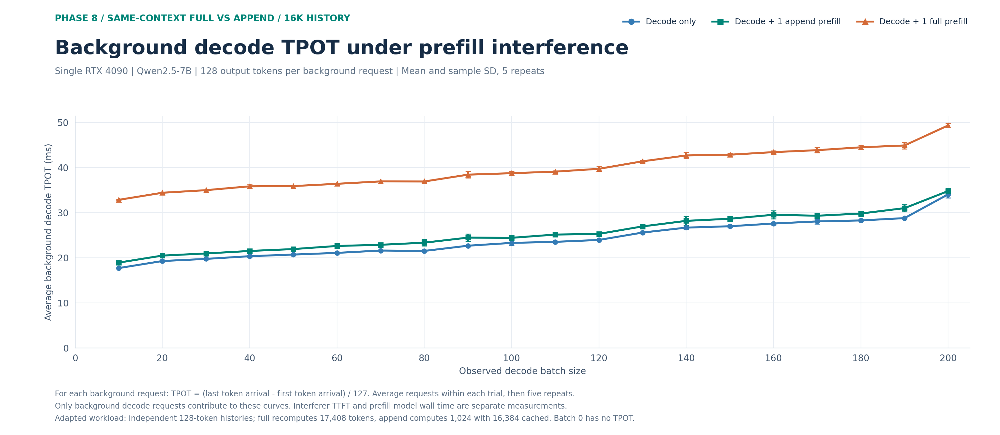

# Phase 8：Figure 2 适配实验与诊断

最新新增 [历史长度 × 调度预算诊断](history-budget-diagnostic/README.md)：五组配置、batch=10/100/200、每点三次重复，区分历史重算规模和 prefill 分块对背景 TPOT 的影响，详见[诊断报告](../../../docs/TWO_NODE_PHASE8_DIAGNOSTIC.md)。该诊断尚未证明论文“小 batch 接近、大 batch 明显分离”的趋势。

原 **16K 历史、同完整输入、独立背景 KV、batch 0～200** 实验继续保留作为参考。完整图表、数据快照和重画代码放在 [context16k/](context16k/README.md)。以下数值属于该原实验。

Full 与 Append 提交相同的 16,384-token 历史和 1,024-token 新输入：Full 重算全部 17,408 token；Append 复用历史，仅计算新增 1,024 token。背景请求各有独立的 128-token 历史，输出 128 token。每点重复五次，共 310 个 trial、63,520 条请求。

| Batch 200 条件 | 背景平均 TPOT（ms） |
|---|---:|
| 无干扰 | 34.09 ± 0.82 |
| 加 Append | 34.82 ± 0.55 |
| 加 Full | 49.38 ± 0.48 |

均值 ± 五次重复的样本标准差。TPOT 仅统计背景 decode 请求，从首 token 到末 token 的 127 个间隔计算；不混入干扰请求自身的 TTFT，但干扰造成的背景等待仍包含在 TPOT 中。

六张图包括：背景平均 TPOT、prefill 耗时、插入前后逐步耗时、不同窗口的干扰增幅、累计额外延迟，以及均摊到 128 个输出 token 的额外延迟。每张提供 PNG、SVG、PDF。

- [图表说明、全部图片及重画方法](context16k/README.md)
- [实验报告](../../../docs/TWO_NODE_PHASE8_CONTEXT16K.md)
- [复跑指南](../../../experiment_guide/05_FIGURE2.md)

原始证据位于 `artifacts/two-node-phase8-figure2-context16k-evidence/`；本轮先导、中断记录及正式请求均保留，正式曲线只使用已验收的 formal 数据。旧的小 batch、共享历史大 batch 及其 event-window 分析已清理。

这是 RTX 4090 / Qwen2.5-7B 上的适配实验；论文硬件、模型和负载细节与此不同，不声称精确复现论文数值或动态调度收益。
