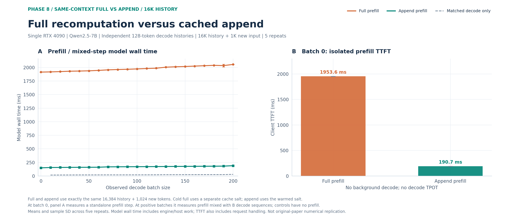
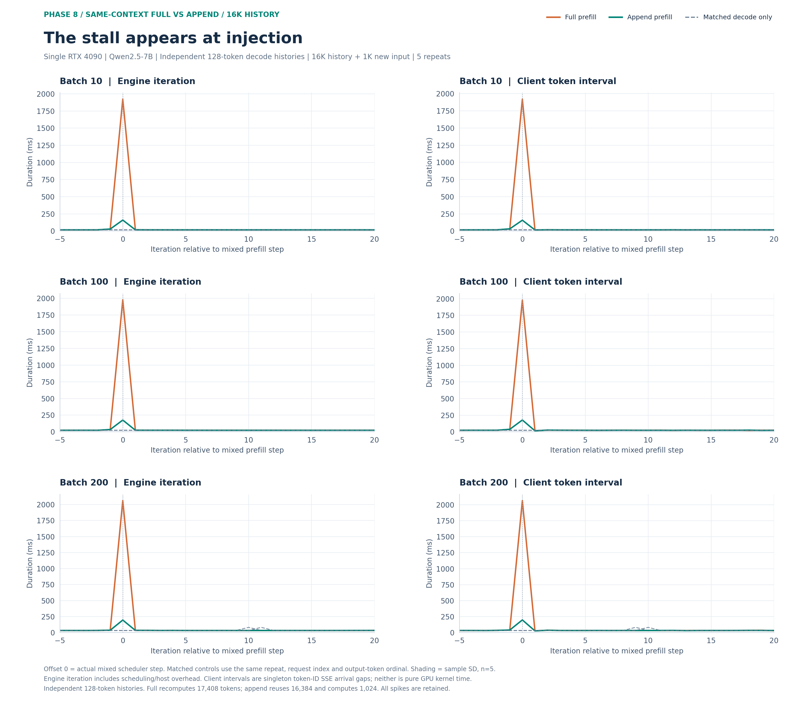
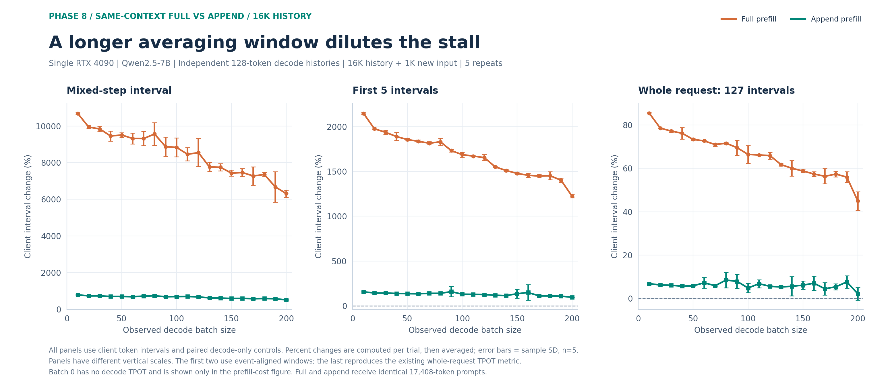
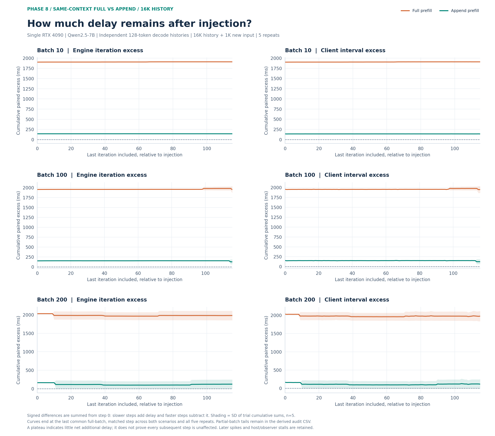
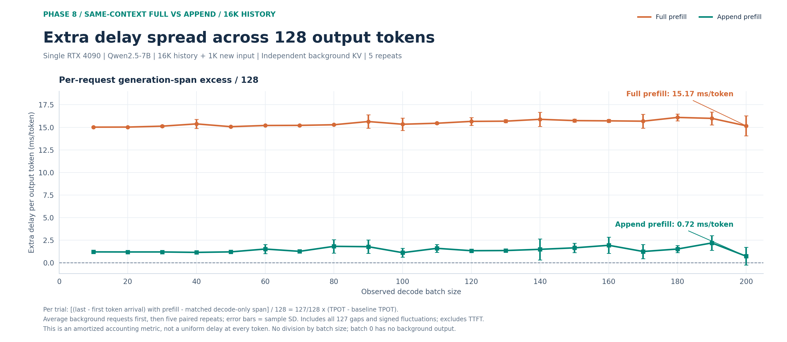
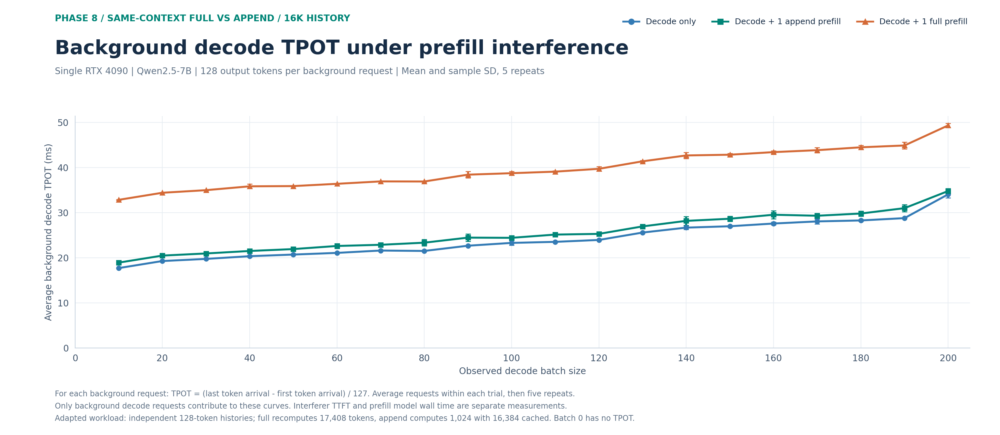

# Figure 2：16K 历史的同上下文 Full / Append 实验

单 RTX 4090 / Qwen2.5-7B。Full 与 append 提交相同的 **16,384-token 历史 + 1,024-token 新输入**；full 冷缓存重算全部 17,408 token，append 复用历史，只计算新增的 1,024 token。背景请求拥有独立的 **128-token 历史 + 4-token 新输入**，各生成 128 token。历史为合成 token 序列，非先前真实问答的记录。

B=0/10/20/.../200，每点五次重复。B0 没有背景 decode，仅测独立 prefill，不赋予 decode TPOT 或 slowdown 数值。单次干扰在所有背景请求至少生成 8 token 后插入，actual batch、缓存命中和计算 token 数由 scheduler trace 验收。

方法、容量与异常记录见[实验报告](../../../../docs/TWO_NODE_PHASE8_CONTEXT16K.md)。历史语义说明与旧实验分开，不改写旧图。

## 图表

首选三条件绝对 TPOT 对照：[background-decode-tpot.png](background-decode-tpot.png)。这张图直接展示纯 decode、加 append、加 full 时的背景平均 TPOT；下列耗时与事件窗口图用于辅助解释。

- `prefill-cost`：从 B0 到 B200 的 prefill／混合步骤模型墙钟，以及 B0 独立请求 TTFT。
- `event-timeline`：B10/100/200 插入前后逐步耗时，分别展示完整引擎 iteration 与客户端 token 间隔。
- `window-dilution`：B10～200 的混合步骤单间隔、前五个间隔及整段 127 个间隔的相对变化，各面板纵轴不同。
- `cumulative-delay`：从插入步骤开始累加带正负号的配对额外延迟，保留后续尖峰。
- `amortized-128-token-delay`：整段生成期间相对纯 decode 的额外耗时，均摊到每条背景请求的 128 个输出 token，单位 ms/token。

每类提供 PNG/SVG/PDF，误差为五次 trial 的样本标准差，不是置信区间。请求、token 和 iteration 不视作独立重复。

## 重画

```bash
pip install -r results/figures/phase8/requirements.txt
python results/figures/phase8/context16k/generate.py --from-snapshot
python results/figures/phase8/context16k/generate-amortized.py
python results/figures/phase8/context16k/generate-decode-tpot.py
```

使用 `--focus-batches 20 80 160 --output-dir /tmp/context16k-other-batches` 可以重画其他 batch 的详细逐步图；概览图仍覆盖全范围。

原始请求/SSE、服务日志和 trace 保存在 `artifacts/two-node-phase8-figure2-context16k-evidence/`；逐 trial/步骤 CSV、恢复阈值、排除清单及输入哈希在 `artifacts/phase8-figure2-context16k-window-analysis/`。GitHub 仅需本目录快照和绘图代码即可重画，不需要传全部原始证据。

正式 310 个 trial、63,520 条请求全部成功并验收通过；包含 31,500 条背景 decode、31,810 条预热和 210 条干扰请求。Full/append 各 105 次 prefill（各含 5 次 B0），均在一个调度步骤内完成指定计算，正 batch 共 200 次混合执行，无抢占。

| Batch | 干扰 | 混合模型步骤 ms | 混合步骤客户端间隔增加 | 前五步客户端间隔增加 | 整段 TPOT 增加 |
|---:|---|---:|---:|---:|---:|
| 10 | Full | 1917.43 ± 1.87 | 10687.49% ± 46.62 pp | 2147.60% ± 8.89 pp | 85.40% ± 0.26 pp |
| 10 | Append | 156.60 ± 0.25 | 783.52% ± 5.06 pp | 156.95% ± 0.55 pp | 6.84% ± 0.18 pp |
| 100 | Full | 1972.41 ± 1.10 | 8836.45% ± 516.62 pp | 1687.37% ± 27.03 pp | 66.38% ± 4.08 pp |
| 100 | Append | 171.28 ± 0.09 | 687.11% ± 73.97 pp | 130.31% ± 3.64 pp | 4.87% ± 2.20 pp |
| 200 | Full | 2054.97 ± 0.95 | 6309.68% ± 200.94 pp | 1223.84% ± 17.67 pp | 44.92% ± 4.28 pp |
| 200 | Append | 189.84 ± 0.30 | 506.61% ± 17.46 pp | 96.29% ± 1.83 pp | 2.18% ± 2.96 pp |

Batch 0 独立 prefill 的 TTFT：Full 1953.57 ± 2.32 ms；Append 190.72 ± 1.65 ms。

本轮曲线中，主要额外延迟集中在 prefill 插入步骤，之后累计延迟总体趋于平台；这支持使用 event-window 展示局部干扰。B200 的 Full 混合步骤耗时约为 Append 的 10.82 倍，但这个比值包含模型其他计算，不能等同于注意力复杂度比。整段 TPOT 的平均会明显稀释插入时的短暂停顿。Append 的整段增幅为 2.18% ± 2.96 个百分点，波动与均值同量级，因此不宜据此声称精确的稳态收益。本轮是 4090/Qwen2.5-7B、合成历史负载下的适配机制实验。

表中是五次 trial 的均值 ± 样本标准差；pp 为百分点。局部百分比按 token 序号匹配的每次 trial 参考值计算，不能与论文未确认的窗口直接比较，也不能把注意力复杂度比当作总体耗时比。

正式 trace 的观测器开销 P99 为 0.145 ms、最大 270.535 ms，超过 1 ms 的步骤 57 个；所有尖峰保留。局部窗口、累计延迟与整段 TPOT 的差异应结合这些波动解释。

实验容器已清理，原 Proxy/P/D 的 ID、镜像与完整 State 校验一致；GPU 无计算进程，未创建镜像。用户中断的首次先导单独保留；正式结果未混入任何先导。




[SVG](prefill-cost.svg) · [PDF](prefill-cost.pdf)




[SVG](event-timeline.svg) · [PDF](event-timeline.pdf)




[SVG](window-dilution.svg) · [PDF](window-dilution.pdf)




[SVG](cumulative-delay.svg) · [PDF](cumulative-delay.pdf)

## 均摊到 128 个输出 token



[SVG](amortized-128-token-delay.svg) · [PDF](amortized-128-token-delay.pdf) · [逐 trial 数据](amortized-128-token-trials.csv)

每次 trial 计算 `127 × (实验 TPOT − 同 batch、同重复的纯 decode TPOT) / 128`。分子是每条请求从首 token 到末 token 的完整生成跨度增量，包含全部 127 个间隔；先对背景请求取平均，再对五次重复计算均值和样本标准差。不包含 TTFT、不再除以 batch size，也不表示每个 token 实际都发生了同样的停顿。负差值和后续波动均保留。B0 没有背景输出，故不绘制。

B200：Full 为 **15.17 ± 1.10 ms/token**，Append 为 **0.72 ± 0.98 ms/token**。Append 的标准差大于均值，应结合误差线理解。这张图使用整段生成跨度；与从插入点开始、仅保留完整 batch 配对步骤的 `cumulative-delay` 图末值覆盖范围不同。

本图复用已验收的数据快照，不重新运行模型；此前四张图及实验原始证据保持原样。

## 三种条件下背景 decode 的平均 TPOT



[SVG](background-decode-tpot.svg) · [PDF](background-decode-tpot.pdf) · [均值及五次 trial 数据](background-decode-tpot-data.json)

三条曲线均仅统计 `role=decode` 的背景请求。每条请求计算 `(最后 token 到达时间 − 首 token 到达时间) / 127`，先对本 trial 的 B 条背景请求取平均，再对五次重复计算均值与样本标准差。干扰请求的 TTFT 和 prefill 模型步骤耗时不进入这三条曲线。

B200：纯 decode **34.09 ± 0.82 ms**，加 append **34.82 ± 0.55 ms**，加 full **49.38 ± 0.48 ms**。本图是绝对 TPOT；`amortized-128-token-delay` 则是减去纯 decode 后再按 128 均摊的额外延迟。

论文 Figure 2 的纵轴为 Average TPOT (ms)，图例为这三种条件；正文未明确给出与本实验一致的 128-token 平均窗口。其 caption 写明两类 prefill “both processing 1,024 tokens”。本轮采用用户指定的同完整上下文对照：Full 重算 17,408，Append 复用 16,384 并计算 1,024。因此这是相同指标形式下的适配实验，不能仅凭曲线或增幅相近就认定原论文负载和统计口径已被精确复现。
