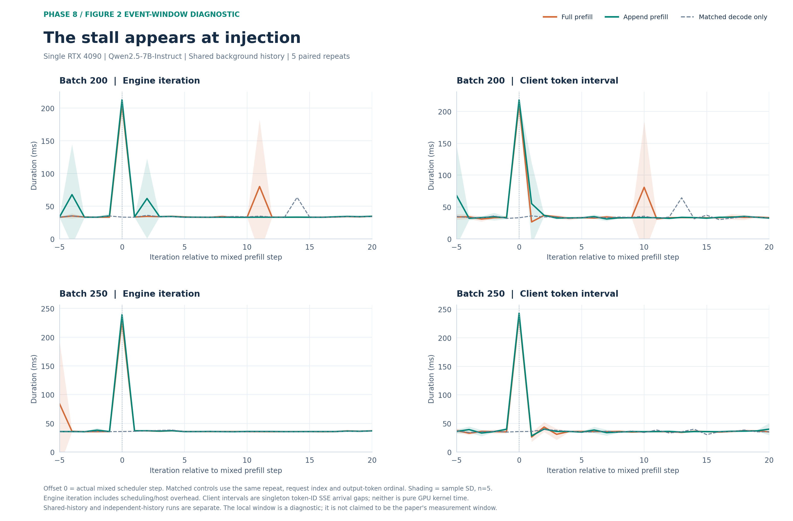
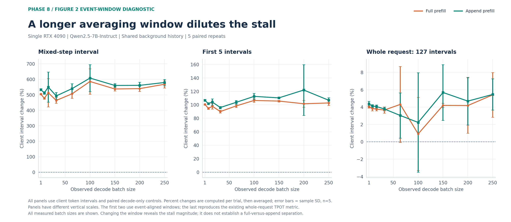
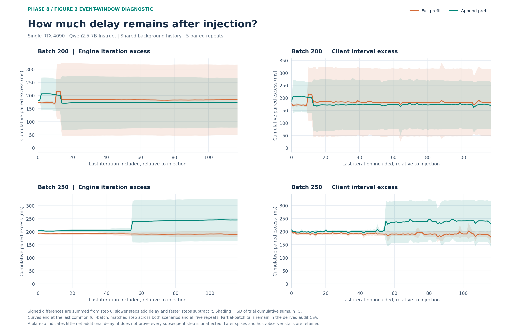

# Figure 2：插入事件附近的干扰诊断

本目录使用已经采集完成的大 batch 实验 trace 和 SSE 做后分析，没有启动新的推理实验。它回答两个问题：一次 prefill 的停顿持续多久，以及将这次停顿平均到整个生成过程会稀释多少。原有整段 TPOT 图继续保存在 [large-batch/](../large-batch/README.md)。

**结果：整段平均确实显著稀释了局部停顿；但在混合步骤及较短窗口内，full 与 append 仍处于相近量级。** 本图不宣称采用了论文 Figure 2 的原始统计窗口，该窗口尚未从论文完整确认。

## 图的含义

| 文件 | 内容 | 阅读方式 |
|---|---|---|
| `event-timeline` | 实际混合步骤前 5 步至后 20 步的引擎完整 iteration 与客户端 token 间隔 | 横轴 0 是执行 1024-token prefill 的调度步骤，观察峰值和之后的波动 |
| `window-dilution` | 混合步骤对应的单个 token 间隔、前 5 个间隔、整个请求 127 个间隔的相对变化 | 三面板均使用客户端到达间隔，纵轴尺度不同；展示平均稀释 |
| `cumulative-delay` | 从混合步骤开始，逐步累加相对纯 decode 的额外耗时 | 保留正负差值；平台只表示净额外延迟不再明显增加，不代表每一步都未受影响 |

共享历史主图聚焦用户关注的 batch 200/250；窗口对比图覆盖全部 9 个 batch。独立历史 batch 32 单独绘图。所有 batch 的逐步统计均保存在快照中，绘图时可以用 `--focus-batches` 选择其他 batch。每张图提供 PNG、SVG 和单页 PDF。

### 共享历史：batch 200 / 250



[SVG](shared-history/event-timeline.svg) · [PDF](shared-history/event-timeline.pdf)



[SVG](shared-history/window-dilution.svg) · [PDF](shared-history/window-dilution.pdf)



[SVG](shared-history/cumulative-delay.svg) · [PDF](shared-history/cumulative-delay.pdf)

### 独立历史：batch 32

[逐步耗时 PNG](independent-history/event-timeline.png) · [窗口稀释 PNG](independent-history/window-dilution.png) · [累计延迟 PNG](independent-history/cumulative-delay.png)

## 配对、窗口和误差

每个干扰 trial 与同组、同 batch、同重复的纯 decode trial 配对。对每个背景请求，用请求序号和**输出 token 序号**匹配参考步骤，而非简单拿两次运行的第 N 步相减。一个调度步骤内请求可能处于不同的输出序号；参考耗时按这些请求各自匹配的步骤取平均。

- `model_ms`：调度器返回到模型输出交回调度器的墙钟耗时，不是 CUDA kernel 时间。
- `cycle_ms`：连续两次调度器 `update_return_ns` 之差，包含模型执行、调度、主机及观测开销；逐步主图的引擎列采用此口径。
- `client_ms`：该步骤产出 token 对应的客户端 token-ID SSE 到达间隔，先对同 trial 的背景请求平均。

实际检查了全部 1,637,760 个 token 事件，每个事件恰含一个 token；没有为合并事件虚构逐 token 时间。整段 TPOT 已从原始事件重算；窗口间隔之和也与首尾时间差交叉核验。

固定窗口包含插入步骤及后续步骤，长度为 1/5/16/32/64；另保存直到匹配完整 batch 结束的窗口。整段 TPOT 包含 127 个间隔，覆盖注入前后整个请求。百分比先在 trial 内按 `(干扰均值 / 配对基线均值 - 1) × 100` 计算，再对 5 次重复求均值。误差带/误差棒为五次 trial 的样本标准差，不是置信区间；请求和 iteration 不当作独立重复。

累计延迟从 step 0 开始，逐步累加带正负号的配对差值。图上只显示两场景、五次重复都有完整 batch 配对的共同范围。204 个启动/收尾的部分 batch 步骤不进入固定 batch 局部统计，排除原因及位置单独保留，整段客户端 TPOT 仍包含整个生成过程。

本次后分析另外定义描述性的“首次局部回归”：从 step 1 开始，寻找连续 5 步的绝对配对差值均不超过 `max(1 ms, 5% × baseline中位数, 3 × 1.4826 × baseline MAD)` 的区间。初始影响窗口在该区间前结束，同时保存 3%/10% 的敏感性结果及后续再次越界的次数。找不到则右删失。这个阈值不是论文要求，也不是显著性检验或因果恢复证明，未用于删除异常点或改变主图窗口。

共享历史组 90 次干扰中，86 次的 `model_ms` 首次回归区间始于 step 1，78 次的 `cycle_ms` 始于 step 1；客户端为 31 次。共享组后面仍有越界的 trial 分别为 41/56/82 次，不能把首次回归解释为此后完全无干扰。独立历史组 10 次的模型/引擎首次回归都始于 step 1。完整结果及限制见[分析报告](../../../../docs/FIGURE2_EVENT_WINDOW_ANALYSIS.md)。

## 重画与证据

只用 GitHub 中的快照即可重画：

```bash
pip install -r results/figures/phase8/requirements.txt
python results/figures/phase8/event-window/generate.py --from-snapshot
```

例如查看 batch 1/32/100 的详细曲线，输出到新目录：

```bash
python results/figures/phase8/event-window/generate.py --from-snapshot \
  --focus-batches 1 32 100 --output-dir /tmp/figure2-window-other-batches
```

从本地原始证据重新分析时，需要新的派生输出目录，脚本拒绝覆盖已有目录：

```bash
python scripts/benchmark/figure2_event_window.py \
  --evidence artifacts/two-node-phase8-figure2-large-batch-evidence \
  --output artifacts/figure2-window-new-analysis
python results/figures/phase8/event-window/generate.py \
  --analysis-dir artifacts/figure2-window-new-analysis
```

派生数据在 `artifacts/phase8-figure2-window-analysis/`：`aligned-iterations.csv` 保存逐 trial/步骤配对数据，`window-trials.csv` 保存各窗口的统计，`recovery-trials.csv` 保存阈值与敏感性，`excluded-partial-steps.csv` 保存部分 batch，`source-manifest.json` 与 `verification.json` 保存输入 SHA256 和验收。所有实际读取的原始证据文件均与上一阶段的 `evidence.sha256` 一致。原始证据及旧图未改写。

后续按相同完整输入重新进行的 16K 历史实验见 [context16k/](../context16k/README.md)。本目录继续保存旧负载的后分析结果。
