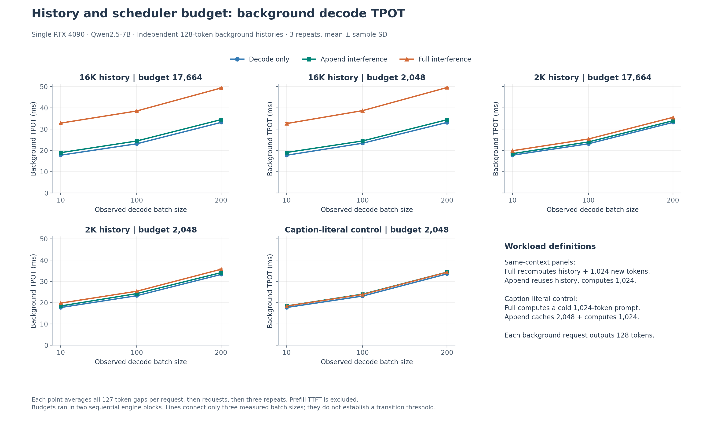
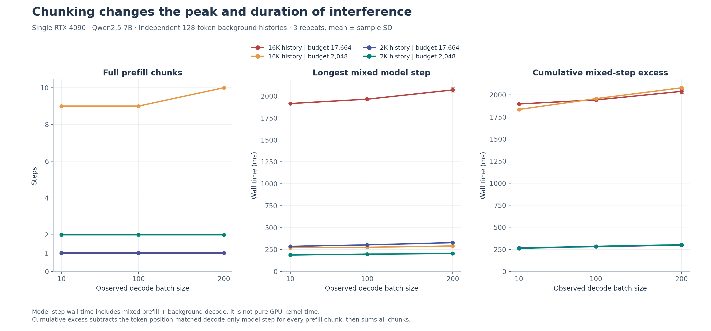
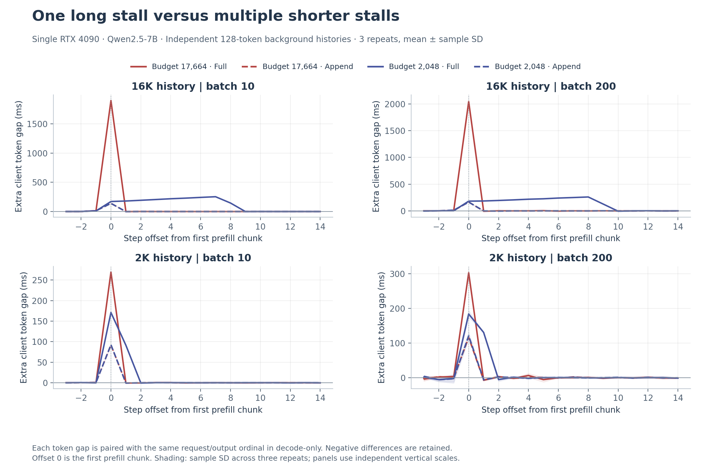
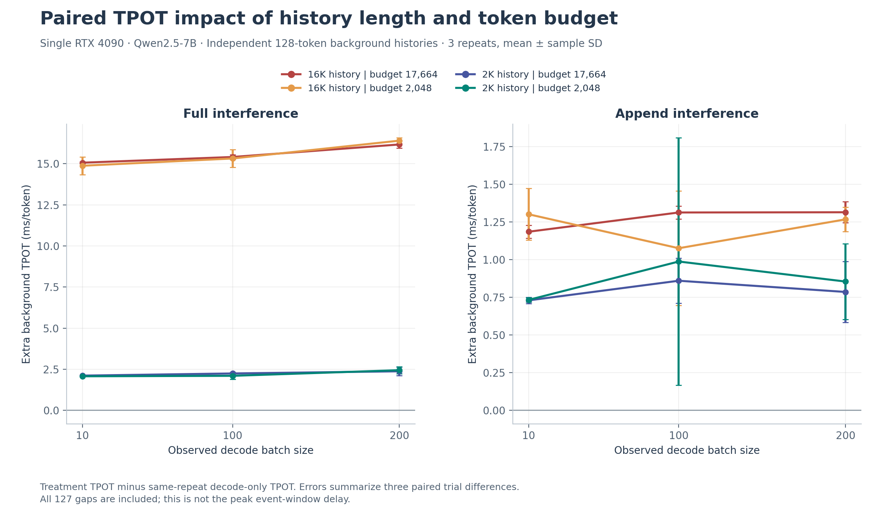

# Phase 8：历史长度 × 调度预算诊断

五组配置，batch=10/100/200，每点三次重复。135 个正式 trial、28,125 条请求通过验收；另有独立先导。Full/Append 干扰请求的自身 TTFT 不进入背景 TPOT。

**结果：缩短干扰历史显著降低 Full 的累计影响；缩小预算主要降低单步峰值，并没有恢复论文“小 batch 接近、大 batch 明显分离”的趋势。** 图注字面条件下，两类都计算 1,024 token，二者背景 TPOT 接近。完整数据及解释见[诊断报告](../../../../docs/TWO_NODE_PHASE8_DIAGNOSTIC.md)。









每图提供 PNG、SVG、PDF。`plot-data.json` 包含每次 trial、各组均值/样本标准差、逐步曲线、GPU 采样摘要、统计口径和原始证据哈希；`generate.py` 可独立重画：

```bash
pip install -r ../requirements.txt
python generate.py
```

从本目录执行上述命令。原始证据位于 `artifacts/phase8-figure2-diagnostic-evidence/`，事件明细位于 `artifacts/phase8-figure2-diagnostic-analysis/`，不需要上传 GitHub 即可重画。

同上下文四组：Full 重算历史＋新增 1,024；Append 复用历史、计算新增 1,024。图注字面条件单独展示，Full 计算无历史的 1,024，Append 缓存 2,048＋计算新增 1,024；论文未公开确认这组历史设定。全部背景使用独立 128-token 历史，输出 128 token。

主图平均全部 127 个输出间隔，先平均请求再平均三次 trial；误差线是样本标准差，不是置信区间。事件图 offset=0 为第一个 prefill 块，保留后续所有块；对照按相同背景请求、相同输出 token 序号配对。差值保留正负。两种预算在两个顺序执行的引擎时间块测量，硬件为 4090/Qwen，不能认定与 H100/Llama 的论文实验条件完全一致。三个离散 batch 点不用于确定饱和阈值。
