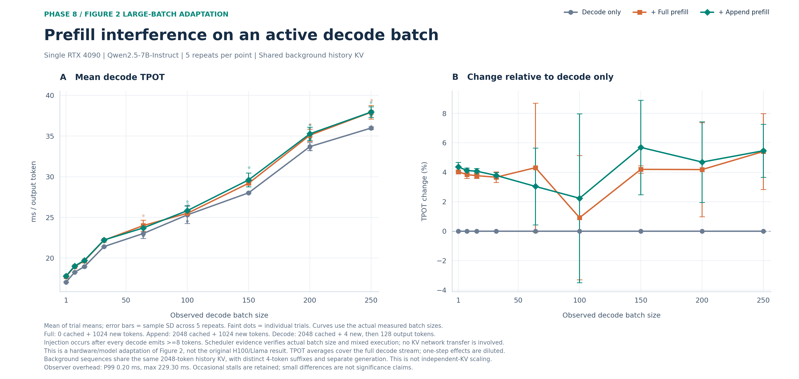
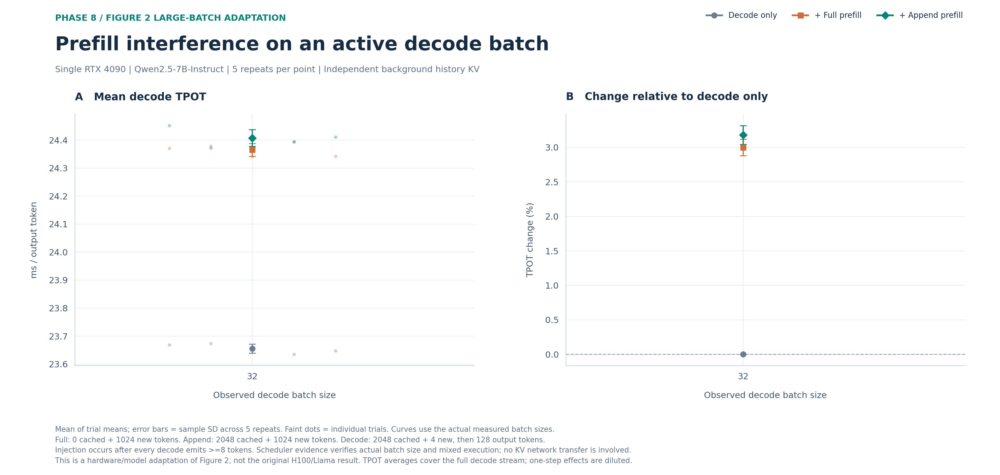

# Figure 2：将 decode batch 扩大到 250

本目录保存单 RTX 4090 / Qwen2.5-7B 的大 batch 补充实验，与[首轮 batch 1–16](../README.md)分开。方法和容量边界见[补充报告](../../../../docs/TWO_NODE_PHASE8_LARGE_BATCH.md)。

共享历史组保持每个背景请求 2048 cached + 4 new → 128 output，但共享 2048-token 历史 KV；每条请求的新 4-token 输入不同，生成分别进行。batch 为 1/8/16/32/64/100/150/200/250，每种场景各五次。它测量大 batch 下的计算干扰，不代表 250 路独立 KV 的容量。独立历史组另测 batch 32，作为原方法的扩展对照。

新图横轴均为线性刻度。每张图左面板是整段 decode TPOT，右面板是相对同 batch/重复的纯 decode 变化；误差棒为五次 trial 的样本标准差。一次 prefill 的即时扰动会被 128-token 平均稀释，不能将右图的百分比视为混合步骤的耗时变化。

## 重新画图

图的 PNG、SVG、PDF 和完整统计快照分别保存到 `shared-history/` 与 `independent-history/`。克隆 GitHub 后不需要原始 evidence，使用父目录的依赖：

```bash
pip install -r results/figures/phase8/requirements.txt
python results/figures/phase8/large-batch/generate.py --from-snapshot
```

本地有完整原始 evidence 时，去掉 `--from-snapshot`，从验收后的统计重新生成。全部请求、SSE、调度 trace、先导及不合格容量点位于 `artifacts/two-node-phase8-figure2-large-batch-evidence/`；不将失败、先导或容量边界数据混入正式曲线。

## 结果

正式 150 个 trial、13660 条请求全部成功并验收通过。batch 250：decode=35.985 ms/token，full=37.930 ms/token，append=37.950 ms/token；full/append 相对变化分别为 +5.41% / +5.46%。

共享历史主图：



[PNG](shared-history/figure2-interference.png) · [SVG](shared-history/figure2-interference.svg) · [PDF](shared-history/figure2-interference.pdf) · [统计快照](shared-history/plot-data.json)

| Batch | Decode TPOT (ms) | Full TPOT (ms) | Append TPOT (ms) | Full 变化 | Append 变化 |
|---:|---:|---:|---:|---:|---:|
| 1 | 17.040 ± 0.039 | 17.726 ± 0.025 | 17.784 ± 0.056 | +4.03% ± 0.14 pp | +4.37% ± 0.31 pp |
| 8 | 18.260 ± 0.017 | 18.962 ± 0.052 | 19.012 ± 0.032 | +3.84% ± 0.27 pp | +4.12% ± 0.17 pp |
| 16 | 18.949 ± 0.033 | 19.663 ± 0.030 | 19.721 ± 0.023 | +3.76% ± 0.19 pp | +4.07% ± 0.19 pp |
| 32 | 21.414 ± 0.028 | 22.199 ± 0.071 | 22.224 ± 0.027 | +3.66% ± 0.36 pp | +3.78% ± 0.20 pp |
| 64 | 23.017 ± 0.596 | 23.993 ± 0.683 | 23.703 ± 0.038 | +4.31% ± 4.38 pp | +3.04% ± 2.60 pp |
| 100 | 25.311 ± 1.073 | 25.506 ± 0.034 | 25.831 ± 0.619 | +0.91% ± 4.22 pp | +2.23% ± 5.73 pp |
| 150 | 28.020 ± 0.065 | 29.196 ± 0.090 | 29.612 ± 0.845 | +4.20% ± 0.25 pp | +5.69% ± 3.21 pp |
| 200 | 33.700 ± 0.487 | 35.100 ± 0.750 | 35.276 ± 0.822 | +4.18% ± 3.19 pp | +4.69% ± 2.75 pp |
| 250 | 35.985 ± 0.168 | 37.930 ± 0.844 | 37.950 ± 0.662 | +5.41% ± 2.58 pp | +5.46% ± 1.80 pp |

独立历史 batch 32 对照：



[PNG](independent-history/figure2-interference.png) · [SVG](independent-history/figure2-interference.svg) · [PDF](independent-history/figure2-interference.pdf) · [统计快照](independent-history/plot-data.json)

| Batch | Decode TPOT (ms) | Full TPOT (ms) | Append TPOT (ms) | Full 变化 | Append 变化 |
|---:|---:|---:|---:|---:|---:|
| 32 | 23.655 ± 0.016 | 24.365 ± 0.023 | 24.408 ± 0.030 | +3.00% ± 0.12 pp | +3.18% ± 0.14 pp |

单位、配对与误差棒口径见上文，pp 为百分点。共享历史会改变物理 KV 读取复用，不能将本图解释为 250 路独立会话的容量。第一次同步写盘采集的异常和完整数据保留在 attempt-sync-io/，不混入最终图。


本轮没有复现论文中 full/append 干扰相差一个数量级的趋势。共享组部分大 batch 的误差棒较大；observer P99 约 0.20 ms、最大约 229.30 ms，偶发停顿全部保留，不能把接近曲线的小差别视为显著收益。单次混合步骤与整段 TPOT 的区别及统计表见补充报告。
