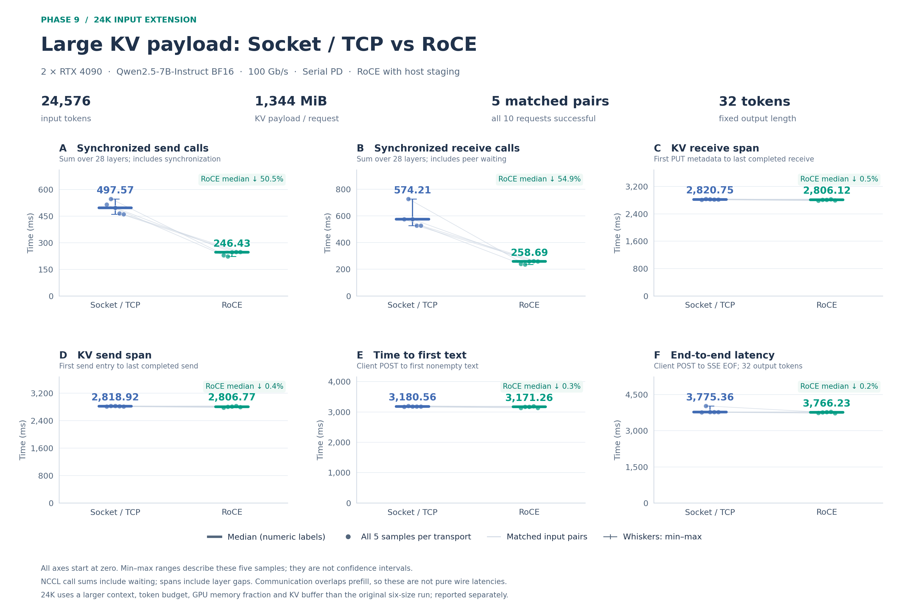

# Phase 9：24K 输入补充结果

输入 24,576 tokens、输出固定32 tokens，双机串行 PD，Socket/RoCE 各5次。10/10正式请求成功，5对输入完全相同。每条实测 KV payload **1,344 MiB**，全部28层。

## 结果图



六个面板分别为：A 发送同步调用累计、B 接收同步调用累计、C KV 接收跨度、D KV 发送跨度、E TTFT、F E2E。单位均为毫秒，纵轴从零开始。蓝色为 Socket/TCP，绿色为 RoCE；圆点为全部样本，粗横线及数字为中位数，误差线为最小/最大值，灰线连接相同输入的配对样本。百分比为两个条件中位数的相对差异，不代表统计显著性。

[PNG](kv-transport-24k.png) · [SVG](kv-transport-24k.svg) · [PDF](kv-transport-24k.pdf)

使用本目录 measurements.json 独立重画，不需要模型服务或原始 artifacts：

```bash
/workspace/ppd-paper-tools/bin/python results/figures/phase9/extension-24k/generate.py
```

依赖版本见 [requirements.txt](requirements.txt)。figure-summary.json 记录绘图指标和数据快照 SHA256。

## 数值与口径

每条件5次测量的中位数 [最小值, 最大值]，单位ms：

| 指标（ms） | Socket / TCP | RoCE（主机内存中转） |
|---|---:|---:|
| TX 同步调用累计 | 497.57 [460.69, 547.77] | 246.43 [222.71, 248.57] |
| RX 同步调用累计 | 574.21 [526.28, 727.39] | 258.69 [235.59, 260.90] |
| KV 接收跨度 | 2820.75 [2813.40, 2838.14] | 2806.12 [2782.68, 2828.83] |
| KV 发送跨度 | 2818.92 [2812.11, 2830.73] | 2806.77 [2783.23, 2829.21] |
| TTFT | 3180.56 [3165.67, 3199.78] | 3171.26 [3130.26, 3187.35] |
| E2E | 3775.36 [3761.34, 4031.71] | 3766.23 [3725.25, 3782.77] |


TX/RX累计为同步 NCCL 调用耗时之和，可能包含对端等待；接收跨度从首层 PUT 元数据到末层同步接收完成，包含层间产出等待。通信与模型计算重叠，不能将累计调用耗时当作纯网络时间或直接推导端到端加速。

- [audited-requests.csv](audited-requests.csv)：全部10条正式样本的计时、字节数和请求标识。
- [measurements.json](measurements.json)：完整数据、计时口径、审计和源证据SHA256。
- [plan.json](plan.json)：24K临时配置与实验前源文件哈希。
- [实验报告](../../../../docs/TWO_NODE_PHASE9_24K.md)：配置、请求构造、预热/清缓存、结果与限制。

24K使用max_model_len=25600、token budget=24576、GPU utilization=0.85、KV buffer=2GiB，配置不同于原六种长度，单独报告。
