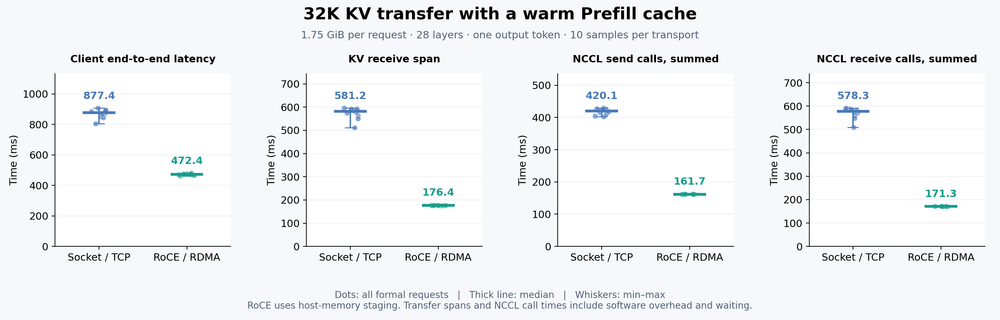

# Phase9扩展：32K输入，P热缓存与D冷缓存

精确32,768输入tokens，固定输出1token，纯串行PD。P保留前缀缓存，D明确关闭本地前缀缓存。每次真实发送并接收28层、1,879,048,192bytes（1.75GiB）KV。

Socket→RoCE→RoCE→Socket共4次独立部署，每块5次正式请求；每协议10次，共20次，全部成功。每次部署另外保留1次冷预热和1次热预热，共8次，不纳入正式统计。每个请求正文完全相同。

## 结果图



四个面板依次是客户端E2E、完整KV接收跨度、28层NCCL发送同步调用累计、28层NCCL接收同步调用累计。所有纵轴均为毫秒、从0开始；散点为全部正式样本，粗线为中位数，误差线为min/max，不是置信区间。另附SVG/PDF。

| 指标（ms，中位数） | Socket/TCP | RoCE/RDMA | RoCE降低 |
|---|---:|---:|---:|
| 客户端TTFT | 876.07 | 471.05 | 46.2% |
| 客户端E2E | 877.37 | 472.36 | 46.2% |
| 发送跨度 | 576.20 | 177.36 | 69.2% |
| 接收跨度 | 581.17 | 176.44 | 69.6% |
| NCCL发送调用累计 | 420.06 | 161.67 | 61.5% |
| NCCL接收调用累计 | 578.30 | 171.32 | 70.4% |

减少大规模Prefill计算后，RoCE的收益能够明显体现在请求延迟上。但E2E仍不是纯网络时间：每请求E2E减接收跨度的中位数，Socket约297ms、RoCE约296ms；该差值不构成互斥阶段分解，不能直接命名为Prefill计算时间。KV提取、装入、少量模型计算、入口及调度仍存在，跨度和NCCL调用也含软件开销与等待。

## 验收与边界

- 全部228项审计通过。P冷预热每次计算32,768tokens，热预热及正式请求每次仅计算16tokens、命中32,752；D每次从远端加载32,767tokens后计算末尾1token。
- 每正式块P本地命中163,760tokens，D本地命中0、远端命中163,835。实际传输字节来自tensor计数，不根据命中token数推算。
- 真实后端日志为NET/Socket和NET/IB/RoCE；GDR关闭，RoCE经主机内存中转。未模拟带宽。
- 每块启动前两端GPU均无其他计算进程；无抢占、无测量期OOM/NCCL WARN。观察器最大记录开销26.258微秒；记录在内存，停测后导出，无额外CUDA同步。
- 临时实验容器已清理，GPU释放，原有Proxy的ID、启动时间及配置保持不变。dcn10干扰任务经用户明确授权后结束。
- max_model_len=32769只是给原生32K输入预留1输出长度；输入前向位置仍为0..32767，未对输出token再做一次前向。其余配置和两次启动修正见阶段报告。
- 每协议只有10次合成负载测量，不能推广为所有长度/并发下的收益。本实验配置及缓存状态与原Phase9/24K不同，独立报告。

## 数据与重画

`plot-data.json`包含20次正式请求、8次预热、完整ID、逐请求时延/字节/调度计数、228项验收及原证据SHA256。此目录可独立上传GitHub，重画不需要模型服务或artifacts：

```bash
python generate.py --from-snapshot
```

依赖见`requirements.txt`。原始请求、完整SSE、事件时间戳、日志、metrics、调度记录、失败启动记录和all-requests.csv均位于`artifacts/two-node-phase9-kv-transport-evidence/extension-hot32k/`；CSV含全部28次请求，以kind区分formal与warmup。

[完整阶段报告](../../../../docs/TWO_NODE_PHASE9_HOT32K.md)。没有提交或推送Git。
